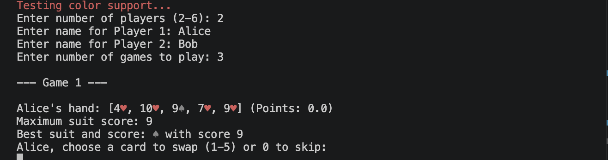
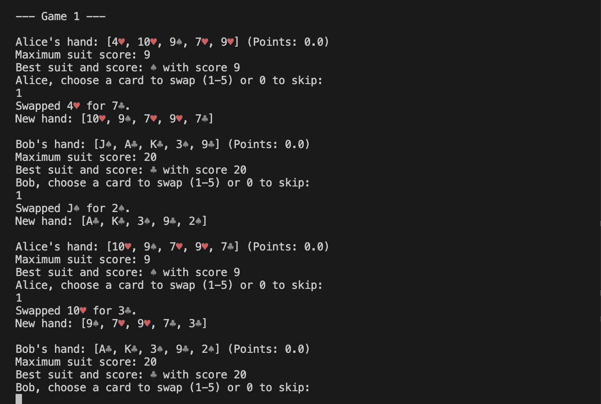
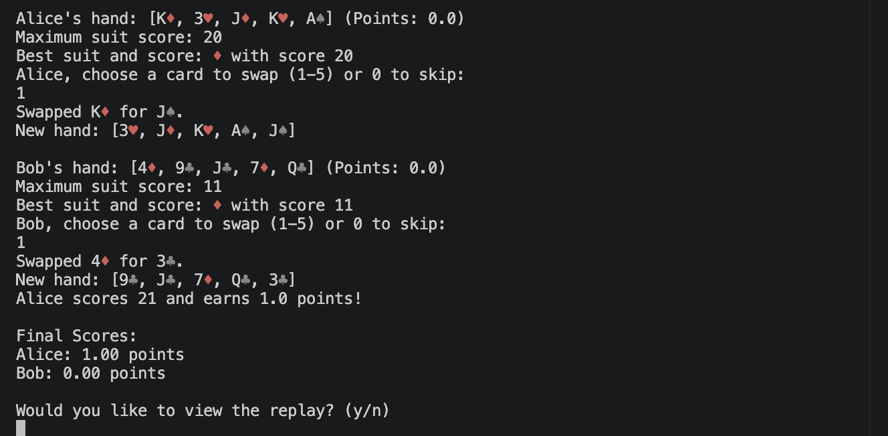

# Suit21

A terminal-based Java card game inspired by 21. The project is built with Maven and runs on Java 25.

## Overview

Suit21 is a simple multiplayer card game where players try to build the strongest suit-based hand without exceeding 21. Players can swap cards, track scores across multiple rounds, and see a replay of the game history.

## Features

- Multiplayer gameplay for 2 to 6 players
- Suit-based scoring logic
- Card swapping and strategy choices
- Score tracking across multiple games
- Replay view of game actions
- Maven build setup
- Java 25 compatibility

## Requirements

- Java 25
- Maven 3.10+

## Run the game

From the project root:

```bash
./run-game.sh
```

Or manually:

```bash
export JAVA_HOME=/opt/homebrew/opt/openjdk@25
export PATH="$JAVA_HOME/bin:$PATH"
mvn clean compile
java -cp target/classes suit21.Suit21
```

## Game flow

1. Enter the number of players.
2. Enter each player's name.
3. Choose the number of games to play.
4. For each turn, choose a card to swap or skip.
5. Final results are displayed after all games.

## Project structure

```text
Suit21Project/
├── pom.xml
├── run-game.sh
├── src/
│   ├── main/java/suit21/
│   └── test/java/suit21/
└── README.md
```

## Notes

This project was set up as a local terminal game and updated to run on the current Java LTS runtime.

## Screenshots

### Start screen


### Gameplay


### Final score
